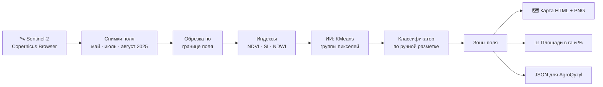

# 🛰 Ғарыштан күріш · Рис из космоса

**Программа берёт бесплатные спутниковые снимки Sentinel-2 рисовых полей Кызылординской области и строит цветную карту: где рис здоровый, где растения в стрессе, где почва засолена или пуста.**

> Қызылорда облысындағы күріш алқаптарының Sentinel-2 серігінен алынған тегін суреттері бойынша сау күріш, күйзеліс, тұзданған және бос жер аймақтарын көрсететін түсті карта жасайтын бағдарлама.

| | |
|---|---|
| Конкурс | INNOFEST Kyzylorda 2026 (4–5 декабря), направление **AI Software Development** |
| Автор | Мардан, школа программирования GRAND master |
| Наставник | Куанышбаев А. Ж. |
| Статус | 🛠 в разработке, готовность к 3 декабря 2026 |
| Командный проект | [AgroQyzyl](https://github.com/schoolprogramminggm-lab/innofest-agroqyzyl): эта программа работает модулем «карта поля» |

---

## 1. Проблема

Кызылординская область — главный рисовый регион Казахстана. Урожай риса снижают две беды:

- **засоление почв:** соль поднимается к поверхности с грунтовыми водами, и на таких участках рис растёт плохо или не растёт совсем;
- **нехватка воды:** рис растёт в затопленных чеках, и если воды мало, растения уходят в стресс.

Поле в десятки гектаров пешком не обойдёшь, а проблемные участки с земли видно поздно. **Спутник видит поле целиком** и снимает его каждые несколько дней, бесплатно.

## 2. Решение

Программа скачивает снимки поля со спутника Sentinel-2 за сезон, считает по ним индексы растительности и засоления, а **искусственный интеллект делит поле на зоны**:

| Цвет | Зона | Что значит для фермера |
|---|---|---|
| 🟩 | Здоровый рис | Всё в порядке |
| 🟨 | Стресс | Рис растёт хуже: проверить воду, удобрения, листья на болезни |
| ⬜ | Засоление | Соль в почве: промывка, дренаж, солеустойчивые сорта |
| 🟦 | Вода / пустая земля | Затопленный или незасеянный участок |

На выходе **интерактивная карта** с цветными зонами и таблица площадей:

```
Поле № 2 (Сырдарьинский р-н), август 2025
🟩 Здоровый рис ....... 38,4 га  (71%)
🟨 Стресс ............. 9,2 га   (17%)
⬜ Засоление .......... 4,1 га   (8%)
🟦 Вода / пусто ....... 2,3 га   (4%)
⚠️ Засоление выросло с мая на 3% — северо-восточный угол поля
```

## 3. Как это работает



### 3.1. Что видит спутник

Sentinel-2 — европейские спутники программы Copernicus. Они снимают Землю не только в видимом свете, но и в **инфракрасном**, которое не видно глазу. Один пиксель снимка — квадрат **10 × 10 м на земле**, то есть **100 м² = 0,01 га**. По числу пикселей зоны сразу считается её площадь.

Используемые каналы (bands):

| Канал | Цвет | Длина волны | Зачем |
|---|---|---|---|
| B2 | синий | 490 нм | индекс засоления |
| B3 | зелёный | 560 нм | индекс воды |
| B4 | красный | 665 нм | растительность, засоление |
| B8 | ближний инфракрасный (NIR) | 842 нм | растительность, вода |

### 3.2. Индексы

**NDVI — зелёная масса растений:**

```
NDVI = (B8 − B4) / (B8 + B4)
```

Здоровый лист отражает много инфракрасного света и поглощает красный, поэтому NDVI высокий (0,6–0,9). У больных и угнетённых растений он ниже, у голой земли и соли около 0,1, у воды меньше нуля.

**SI — индекс засоления (Salinity Index):**

```
SI = √(B2 × B4)
```

Соль на поверхности белая и ярко отражает синий и красный свет, поэтому на засоленных участках SI высокий.

**NDWI — вода:**

```
NDWI = (B3 − B8) / (B3 + B8)
```

Положительные значения — вода (затопленные чеки, каналы).

### 3.3. Искусственный интеллект

1. **KMeans** (обучение без учителя) сам делит все пиксели поля на группы похожих по трём признакам: NDVI, SI, NDWI. Ему не нужно заранее говорить, где что.
2. **Ручная разметка:** по снимку вручную отмечаются **100+ точек** с известной зоной (здесь точно рис, здесь точно соль). Файл `labels/points.csv`.
3. **Классификатор** (Random Forest) учится на размеченных точках и раскрашивает каждый пиксель поля. Часть точек откладывается для проверки, на них считается **точность (цель ≥ 75%)**.

### 3.4. Сезон риса и даты снимков

| Месяц | Что на поле | Что покажет карта |
|---|---|---|
| Май | Посев, чеки затоплены | Много воды, видно незасеянные и засоленные участки |
| Июль | Активный рост | Максимум NDVI, хорошо видны зоны стресса |
| Август | Созревание | Итог сезона: где рис вырос, где нет |

Сравнение трёх дат показывает, **как менялось поле за сезон** и где засоление растёт.

## 4. Технологии

| Часть | Технология | Зачем |
|---|---|---|
| Язык | Python 3.11 | Основной язык проекта |
| Снимки | [Copernicus Browser](https://browser.dataspace.copernicus.eu/), Sentinel-2 L2A | Бесплатные спутниковые снимки |
| Чтение снимков | rasterio | GeoTIFF, обрезка по границе поля |
| Вычисления | NumPy | Индексы по каждому пикселю |
| ИИ | scikit-learn | KMeans, Random Forest, точность |
| Карта | folium | Интерактивная карта в браузере |
| Графики | matplotlib | PNG-карты и графики сравнения |
| Границы полей | GeoJSON ([geojson.io](https://geojson.io/)) | Контур каждого поля |

Бюджет проекта: **0 тг**, все инструменты и данные бесплатные.

## 5. Поля

*Заполняется на этапе «ТЗ и старт».*

| № | Поле (район, рядом с каким посёлком) | Координаты центра | Площадь, га | Файл границы |
|---|---|---|---|---|
| 1 | — | — | — | `fields/field_1.geojson` |
| 2 | — | — | — | `fields/field_2.geojson` |
| 3 | — | — | — | `fields/field_3.geojson` |

**Снимки (без облаков над полем):**

| Поле | Май 2025 | Июль 2025 | Август 2025 |
|---|---|---|---|
| 1 | — | — | — |
| 2 | — | — | — |
| 3 | — | — | — |

## 6. Результаты

*Заполняется на этапах «Разработка» и «Доводка».*

| Метрика | Требование | Результат |
|---|---|---|
| Точность зон на проверочных точках | ≥ 75% | — |
| Размеченных точек | ≥ 100 | — |
| Время расчёта одного поля (ноутбук) | ≤ 1 мин | — |

**Площади зон, август 2025:**

| Поле | Здоровый рис | Стресс | Засоление | Вода / пусто |
|---|---|---|---|---|
| 1 | — | — | — | — |
| 2 | — | — | — | — |
| 3 | — | — | — | — |

## 7. Установка и запуск

**Нужно:** Python 3.11, Git, бесплатный аккаунт на [dataspace.copernicus.eu](https://dataspace.copernicus.eu/).

```bash
# 1. Скачать проект
git clone https://github.com/schoolprogramminggm-lab/innofest-space-rice.git
cd innofest-space-rice

# 2. Виртуальное окружение
python -m venv venv
venv\Scripts\activate          # Windows
# source venv/bin/activate     # Linux / macOS

# 3. Библиотеки
pip install -r requirements.txt
```

**Скачать снимки:**
1. Войти в [Copernicus Browser](https://browser.dataspace.copernicus.eu/).
2. Найти поле, выбрать **Sentinel-2 L2A**, дату без облаков (фильтр облачности ≤ 10%).
3. **Download → Analytical**, формат **TIFF (32-bit float)**, каналы **B02, B03, B04, B08**, разрешение **10 м**.
4. Сохранить в `data/field_1/2025-07/` (и так для каждого поля и месяца).

**Запуск:**

```bash
# расчёт одного поля за одну дату
python run.py --field field_1 --date 2025-07

# сравнение дат
python run.py --field field_1 --compare 2025-05 2025-08
```

Готовые карты появятся в `output/`: `field_1_2025-07.html` (интерактивная), `field_1_2025-07.png` (картинка) и `field_1_2025-07.json` (цифры для AgroQyzyl).

> Снимки (`data/`) в репозиторий не загружаются, они весят сотни мегабайт. Готовые карты и цифры (`output/`) хранятся в репозитории.

## 8. Структура проекта

```
innofest-space-rice/
├── fields/                # границы полей (GeoJSON)
│   ├── field_1.geojson
│   ├── field_2.geojson
│   └── field_3.geojson
├── src/
│   ├── load.py            # чтение каналов, обрезка по границе поля
│   ├── indices.py         # NDVI, SI, NDWI
│   ├── zones.py           # KMeans + классификатор зон
│   ├── area.py            # площади зон в га и %
│   ├── maps.py            # карта folium (HTML) и PNG
│   └── export.py          # JSON для командного бота AgroQyzyl
├── labels/
│   └── points.csv         # ручная разметка: широта, долгота, зона
├── tests/
│   └── test_indices.py    # проверка формул индексов
├── output/                # готовые карты и цифры
├── data/                  # снимки (не в git)
├── run.py                 # точка запуска
├── requirements.txt
└── README.md
```

## 9. Формат для AgroQyzyl

*Согласовывается с Санжаром до 14 ноября. Пример:*

```json
{
  "field": "field_2",
  "date": "2025-08",
  "area_ha": 54.0,
  "zones": {
    "healthy":  {"ha": 38.4, "pct": 71},
    "stress":   {"ha": 9.2,  "pct": 17},
    "salinity": {"ha": 4.1,  "pct": 8},
    "water":    {"ha": 2.3,  "pct": 4}
  },
  "problem_area": "северо-восточный угол",
  "map_png": "output/field_2_2025-08.png"
}
```

## 10. Карта без интернета

На сцене может не быть Wi-Fi. Интерактивная карта folium подгружает подложку и библиотеку из интернета, поэтому для демо готовятся **две версии**:
- **PNG-карта** с зонами и легендой: открывается всегда;
- **HTML-отчёт** со встроенной PNG-картой и таблицей площадей: открывается в браузере без интернета.

Интерактивная карта показывается, если интернет есть.

## 11. План работы

Задачи ведутся в [Issues](../../issues) и разбиты по [этапам (Milestones)](../../milestones):

| Этап | Срок | Результат |
|---|---|---|
| 1. ТЗ и старт | до 7 ноября | Окружение, 3 поля выбраны, снимки за 3 месяца скачаны |
| 2. Прототипы | до 14 ноября | NDVI, индекс засоления, зоны KMeans, карта folium, формат JSON |
| 3. Разработка | до 21 ноября | Разметка 100+ точек, классификатор ≥ 75%, площади, модуль для AgroQyzyl |
| 4. Доводка | до 28 ноября | Сравнение май → август, офлайн-карты, слайды, финальный README |
| 5. Защита | до 3 декабря | Репетиции, выступление 3 минуты |

**Правила работы:**
1. Каждое занятие начинается с отчёта на 2 минуты: что сделал, что делаю сегодня.
2. Коммит в конце каждого занятия с понятным описанием на русском или казахском.
3. В 16:25 наставник проверяет задачи дня.
4. Всё, что показываем на сцене, работает вживую. Видео-демо только запасной вариант.

## 12. Демонстрация на INNOFEST

Открываем карту поля и показываем жюри: вот здесь в мае была вода, в июле рис рос, а в этом углу засоление за сезон выросло, и рис там не взошёл. Цифры площадей в гектарах говорят фермеру, сколько земли теряется.

---

*Проект подготовлен в школе программирования GRAND master, Кызылорда, 2026.*
