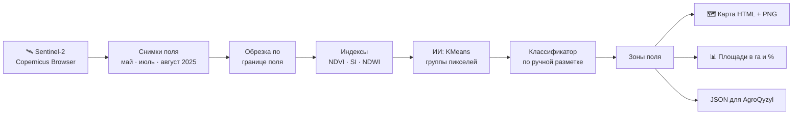

# 🛰 SpaceRice AI · Ғарыштан күріш AI

**Программа берёт бесплатные спутниковые снимки Sentinel-2 рисовых полей Кызылординской области и строит цветную карту: где рис здоровый, где растения в стрессе, где почва засолена или пуста.**

> Қызылорда облысындағы күріш алқаптарының Sentinel-2 серігінен алынған тегін суреттері бойынша сау күріш, күйзеліс, тұзданған және бос жер аймақтарын көрсететін түсті карта жасайтын бағдарлама.

| | |
|---|---|
| Конкурс | INNOFEST Kyzylorda 2026 (4–5 декабря), направление **AI Software Development** |
| Автор | Мардан, школа программирования GRAND master |
| Наставник | Куанышбаев А. Ж. |
| Статус | 🛠 в разработке, готовность к 3 декабря 2026 |
| Командный проект | AgroQyzyl: эта программа отдаёт данные модулю бота RiceDoctor («карта поля») |

---

## 1. Проблема

Кызылординская область — главный рисовый регион Казахстана. Урожай риса снижают две беды:

- **засоление почв:** соль поднимается к поверхности с грунтовыми водами, и на таких участках рис растёт плохо или не растёт совсем;
- **нехватка воды:** рис растёт в затопленных чеках, и если воды мало, растения уходят в стресс.

Поле в десятки гектаров пешком не обойдёшь, а проблемные участки с земли видно поздно. **Спутник видит поле целиком** и снимает его каждые несколько дней, бесплатно.

## 2. Решение

Программа скачивает снимки поля со спутника Sentinel-2 за сезон, считает по ним индексы растительности и засоления, а **искусственный интеллект делит поле на зоны**:

| Цвет | Зона | Что значит для фермера |
|---|---|---|
| 🟩 | Здоровый рис | Всё в порядке |
| 🟨 | Стресс | Рис растёт хуже: проверить воду, удобрения, листья на болезни |
| ⬜ | Засоление | Соль в почве: промывка, дренаж, солеустойчивые сорта |
| 🟦 | Вода / пустая земля | Затопленный или незасеянный участок |

На выходе **интерактивная карта** с цветными зонами и таблица площадей:

```
Поле № 2 (Сырдарьинский р-н), август 2025
🟩 Здоровый рис ....... 38,4 га  (71%)
🟨 Стресс ............. 9,2 га   (17%)
⬜ Засоление .......... 4,1 га   (8%)
🟦 Вода / пусто ....... 2,3 га   (4%)
⚠️ Засоление выросло с мая на 3% — северо-восточный угол поля
```

## 3. Как это работает



### 3.1. Что видит спутник

Sentinel-2 — европейские спутники программы Copernicus. Они снимают Землю не только в видимом свете, но и в **инфракрасном**, которое не видно глазу. Один пиксель снимка — квадрат **10 × 10 м на земле**, то есть **100 м² = 0,01 га**. По числу пикселей зоны сразу считается её площадь.

Используемые каналы (bands):

| Канал | Цвет | Длина волны | Зачем |
|---|---|---|---|
| B2 | синий | 490 нм | индекс засоления |
| B3 | зелёный | 560 нм | индекс воды |
| B4 | красный | 665 нм | растительность, засоление |
| B8 | ближний инфракрасный (NIR) | 842 нм | растительность, вода |

### 3.2. Индексы

**NDVI — зелёная масса растений:**

```
NDVI = (B8 − B4) / (B8 + B4)
```

Здоровый лист отражает много инфракрасного света и поглощает красный, поэтому NDVI высокий (0,6–0,9). У больных и угнетённых растений он ниже, у голой земли и соли около 0,1, у воды меньше нуля.

**SI — индекс засоления (Salinity Index):**

```
SI = √(B2 × B4)
```

Соль на поверхности белая и ярко отражает синий и красный свет, поэтому на засоленных участках SI высокий.

> **Источник формулы.** Это SI из семейства простых индексов засоления по видимым каналам `√(синий × красный)`; в сводке индексов он приписан Khan & Sato, 2001 ([каталог индексов](https://sites.google.com/view/newlifefordrylands/remote-sensing-indices-list/si-salinity-index)). Саму статью мы не проверяли. Канал **B11** (SWIR) скачан вместе с остальными, но в SI пока **не используется**: опубликованную формулу SI именно по B2/B4/B11 найти не удалось, а выдумывать формулу нельзя. Если найдём источник, заменим `si()` в `src/indices.py`.

**NDWI — вода:**

```
NDWI = (B3 − B8) / (B3 + B8)
```

Положительные значения — вода (затопленные чеки, каналы).

### 3.3. Искусственный интеллект

1. **KMeans** (обучение без учителя) сам делит все пиксели поля на группы похожих по трём признакам: NDVI, SI, NDWI. Ему не нужно заранее говорить, где что.
2. **Ручная разметка:** по снимку вручную отмечаются **100+ точек** с известной зоной (здесь точно рис, здесь точно соль). Файл `labels/points.csv`.
**Как KMeans-группы получают названия** (`src/zones.py`). KMeans даёт группам только номера, поэтому название определяется по **средним значениям индексов в группе**, а не по номеру:

| Зона | Правило |
|---|---|
| 🟩 Здоровый рис | группа с самым высоким NDVI |
| 🟨 Стресс | группа со вторым по высоте NDVI |
| ⬜ Засоление | из двух групп с самым низким NDVI: та, где SI выше |
| 🟦 Вода / пусто | из двух групп с самым низким NDVI: та, где SI ниже |

Перед KMeans индексы приводятся к одному масштабу (`StandardScaler`), иначе SI (около 0,1) почти не влиял бы на деление. Важно: KMeans **всегда** делит поле на 4 группы, даже если на поле, например, нет соли, и тогда группа «засоление» будет просто самой светлой землёй. Поэтому площади на этом этапе предварительные, а настоящие зоны даст классификатор на ручной разметке (пункт 3).

3. **Классификатор** (Random Forest) учится на размеченных точках и раскрашивает каждый пиксель поля. Часть точек откладывается для проверки, на них считается **точность (цель ≥ 75%)**.

### 3.4. Сезон риса и даты снимков

| Месяц | Что на поле | Что покажет карта |
|---|---|---|
| Май | Посев, чеки затоплены | Много воды, видно незасеянные и засоленные участки |
| Июль | Активный рост | Максимум NDVI, хорошо видны зоны стресса |
| Август | Созревание | Итог сезона: где рис вырос, где нет |

Сравнение трёх дат показывает, **как менялось поле за сезон** и где засоление растёт.

## 4. Технологии

| Часть | Технология | Зачем |
|---|---|---|
| Язык | Python 3.11 | Основной язык проекта |
| Снимки | [Copernicus Browser](https://browser.dataspace.copernicus.eu/), Sentinel-2 L2A | Бесплатные спутниковые снимки |
| Чтение снимков | rasterio | GeoTIFF, обрезка по границе поля |
| Вычисления | NumPy | Индексы по каждому пикселю |
| ИИ | scikit-learn | KMeans, Random Forest, точность |
| Карта | folium | Интерактивная карта в браузере |
| Графики | matplotlib | PNG-карты и графики сравнения |
| Границы полей | GeoJSON ([geojson.io](https://geojson.io/)) | Контур каждого поля |

Бюджет проекта: **0 тг**, все инструменты и данные бесплатные.

## 5. Поля

Три поля Жалагашского района рядом с посёлком имени Бухарбай батыра (трасса М-32). Поля выбраны разных типов:

| № | Тип | Поле (район, рядом с каким посёлком) | Координаты центра | Площадь, га | Файл границы |
|---|---|---|---|---|---|
| 1 | Хорошее (ровно зелёное) | Жалагашский р-н, у пос. им. Бухарбай батыра (трасса М-32) | 44.9780, 64.5443 | ~110 | `fields/field_1.geojson` |
| 2 | Засолённое (белые чеки) | Жалагашский р-н, там же | 44.9815, 64.5124 | ~91 | `fields/field_2.geojson` |
| 3 | Смешанное | Жалагашский р-н, там же | 44.9716, 64.5267 | ~117 | `fields/field_3.geojson` |

**Снимки:** Sentinel-2 L2A, облачность < 20%, самый безоблачный снимок месяца (скачиваются командой `python src/download.py`).

| Поле | Май 2025 | Июль 2025 | Август 2025 |
|---|---|---|---|
| 1 | ✅ `data/field_1_2025-05.tif` | ✅ `data/field_1_2025-07.tif` | ✅ `data/field_1_2025-08.tif` |
| 2 | ✅ `data/field_2_2025-05.tif` | ✅ `data/field_2_2025-07.tif` | ✅ `data/field_2_2025-08.tif` |
| 3 | ✅ `data/field_3_2025-05.tif` | ✅ `data/field_3_2025-07.tif` | ✅ `data/field_3_2025-08.tif` |

Цветные превью лежат в `output/` (`field_1_2025-05.png` и т. д.).

## 6. Результаты

*Заполняется на этапах «Разработка» и «Доводка».*

| Метрика | Требование | Результат |
|---|---|---|
| Точность зон на проверочных точках | ≥ 75% | — |
| Размеченных точек | ≥ 100 | — |
| Время расчёта одного поля (ноутбук) | ≤ 1 мин | — |

**Площади зон, август 2025:**

*Предварительно: только KMeans, без классификатора на ручной разметке (см. раздел 3.3). Полные цифры за все месяцы: `output/summary.json`.*

| Поле | Здоровый рис | Стресс | Засоление | Вода / пусто |
|---|---|---|---|---|
| 1 | 35,3 га | 40,2 га | 10,1 га | 25,0 га |
| 2 | 34,6 га | 36,8 га | 1,8 га | 18,3 га |
| 3 | 30,6 га | 31,4 га | 37,2 га | 17,8 га |

## 7. Установка и запуск

**Нужно:** Python 3.11, Git, бесплатный аккаунт на [dataspace.copernicus.eu](https://dataspace.copernicus.eu/).

```bash
# 1. Скачать проект
git clone https://github.com/schoolprogramminggm-lab/innofest-space-rice.git
cd innofest-space-rice

# 2. Виртуальное окружение
python -m venv venv
venv\Scripts\activate          # Windows
# source venv/bin/activate     # Linux / macOS

# 3. Библиотеки
pip install -r requirements.txt
```

### Как скачать снимки

Снимки скачивает программа `src/download.py`: для каждого поля из `fields/` она берёт самый безоблачный снимок Sentinel-2 L2A за май, июль и август 2025 (облачность меньше 20%).

1. **Зарегистрируйтесь** на [dataspace.copernicus.eu](https://dataspace.copernicus.eu/) и создайте ключ: *Dashboard → User Settings → OAuth clients → Create*.
2. **Создайте файл `.env`:** скопируйте `.env.example` в `.env` и впишите `CDSE_CLIENT_ID` и `CDSE_CLIENT_SECRET`. Файл `.env` не попадает в git, никому его не показывайте.
3. **Положите границы полей** в папку `fields/` (`field_1.geojson`, `field_2.geojson`, `field_3.geojson`), как описано в issue #3.
4. **Запустите** (с включённым venv): `python src/download.py`
5. **Проверьте результат:** снимки лежат в `data/` (`field_1_2025-07.tif`, каналы B02, B03, B04, B08, B11), цветные превью в `output/` (`field_1_2025-07.png`). Уже скачанные файлы программа пропускает; если за месяц нет снимка с облачностью < 20%, она напишет об этом.

Проверка без интернета: `python -m pytest tests`.

**Запуск** (после скачивания снимков):

```bash
# все поля: индексы -> зоны -> карты, площади зон в консоль
python run.py

# только одно поле
python run.py --field field_1
```

Результат в `output/`:
- `ndvi_field_1_2025-07.png`: картинка NDVI поля за месяц (шкала красный → зелёный);
- `map_field_1.html`: интерактивная карта поля: спутник, контур, цветные зоны, легенда на русском и казахском; месяцы (май, июль, август) переключаются справа. Нужен интернет для подложки;
- `summary.json`: площади зон в гектарах и процентах по каждому полю и месяцу;
- `field_1_2025-07.json`: ответ для бота AgroQyzyl по одному полю и месяцу (раздел 9).

Тесты без интернета: `python -m pytest`.

> Снимки (`data/`) в репозиторий не загружаются, они весят сотни мегабайт. Готовые карты и цифры (`output/`) хранятся в репозитории.

## 8. Структура проекта

```
innofest-space-rice/
├── fields/                # границы полей (GeoJSON)
│   ├── field_1.geojson
│   ├── field_2.geojson
│   └── field_3.geojson
├── src/
│   ├── download.py        # скачивание снимков Sentinel-2 по полям
│   ├── load.py            # чтение каналов, обрезка по границе поля
│   ├── indices.py         # NDVI, SI, NDWI
│   ├── zones.py           # KMeans + классификатор зон
│   ├── area.py            # площади зон в га и %
│   ├── maps.py            # карта folium (HTML) и PNG
│   └── export.py          # JSON для командного бота AgroQyzyl
├── labels/
│   └── points.csv         # ручная разметка: широта, долгота, зона
├── docs/
│   └── agroqyzyl-format.md        # единый формат JSON для AgroQyzyl
├── examples/
│   └── agroqyzyl_space_rice.json  # пример ответа
├── tests/
│   ├── test_download.py   # проверка запроса и имён файлов (без интернета)
│   ├── test_indices.py    # проверка формул индексов
│   ├── test_zones.py      # KMeans даёт 4 зоны, названия по средним
│   ├── test_maps_load.py  # обрезка по контуру поля, карта и легенда
│   └── test_export.py     # JSON для AgroQyzyl: ключи, kk/ru, ошибки
├── output/                # готовые карты и цифры
├── data/                  # снимки (не в git)
├── run.py                 # точка запуска
├── requirements.txt
└── README.md
```

## 9. Формат для AgroQyzyl

Командный бот AgroQyzyl (модуль бота RiceDoctor) получает данные от обеих программ в **одном формате**. Полное описание, оба модуля и примеры ошибок: [docs/agroqyzyl-format.md](docs/agroqyzyl-format.md). Это тот же файл, что в репозитории RiceDoctor.

Общая обёртка:

```json
{"module": "space_rice", "version": 1, "ok": true,
 "result": {...}, "message": {"kk": "...", "ru": "..."}, "error": null}
```

- `ok`: `true`, если данные есть; `false`, если нет (тогда `result` равен `null`, а в `error` причина);
- `message`: готовый текст для пользователя на казахском и русском, есть всегда;
- `result` для SpaceRice (пример: `examples/agroqyzyl_space_rice.json`):

```json
{
  "field": "field_2",
  "date": "2025-08",
  "area_ha": 91.5,
  "zones": {
    "healthy":  {"ha": 34.6, "pct": 37.9},
    "stress":   {"ha": 36.8, "pct": 40.2},
    "salinity": {"ha": 1.8,  "pct": 2.0},
    "water":    {"ha": 18.3, "pct": 20.0}
  },
  "problem_area": null,
  "map_html": "output/map_field_2.html",
  "map_png": "output/ndvi_field_2_2025-08.png"
}
```

`problem_area` («северо-восточный угол») пока `null`: программа ещё не определяет, где на поле проблема.

**Как получить JSON.** `python run.py` сам пишет `output/<поле>_<месяц>.json` для каждого посчитанного поля и месяца. Из кода: `export.to_agroqyzyl("field_2", "2025-08")` (`src/export.py`) берёт цифры из `output/summary.json`. Если за месяц нет данных, вернётся `ok=false` и понятный текст, а не ошибка.

## 10. Карта без интернета

На сцене может не быть Wi-Fi. Интерактивная карта folium подгружает подложку и библиотеку из интернета, поэтому для демо готовятся **две версии**:
- **PNG-карта** с зонами и легендой: открывается всегда;
- **HTML-отчёт** со встроенной PNG-картой и таблицей площадей: открывается в браузере без интернета.

Интерактивная карта показывается, если интернет есть.

## 11. План работы

Задачи ведутся в [Issues](../../issues) и разбиты по [этапам (Milestones)](../../milestones):

| Этап | Срок | Результат |
|---|---|---|
| 1. ТЗ и старт | до 7 ноября | Окружение, 3 поля выбраны, снимки за 3 месяца скачаны |
| 2. Прототипы | до 14 ноября | NDVI, индекс засоления, зоны KMeans, карта folium, формат JSON |
| 3. Разработка | до 21 ноября | Разметка 100+ точек, классификатор ≥ 75%, площади, модуль для AgroQyzyl |
| 4. Доводка | до 28 ноября | Сравнение май → август, офлайн-карты, слайды, финальный README |
| 5. Защита | до 3 декабря | Репетиции, выступление 3 минуты |

**Правила работы:**
1. Каждое занятие начинается с отчёта на 2 минуты: что сделал, что делаю сегодня.
2. Коммит в конце каждого занятия с понятным описанием на русском или казахском.
3. В 16:25 наставник проверяет задачи дня.
4. Всё, что показываем на сцене, работает вживую. Видео-демо только запасной вариант.

## 12. Демонстрация на INNOFEST

Открываем карту поля и показываем жюри: вот здесь в мае была вода, в июле рис рос, а в этом углу засоление за сезон выросло, и рис там не взошёл. Цифры площадей в гектарах говорят фермеру, сколько земли теряется.

---

*Проект подготовлен в школе программирования GRAND master, Кызылорда, 2026.*
