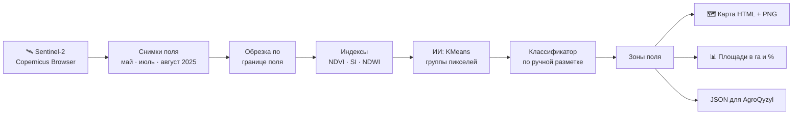

# 🛰 SpaceRice AI · Ғарыштан күріш AI

**Программа берёт бесплатные спутниковые снимки Sentinel-2 рисовых полей Кызылординской области и строит цветную карту: где рис здоровый, где растения в стрессе, где почва засолена или пуста.**

> Қызылорда облысындағы күріш алқаптарының Sentinel-2 серігінен алынған тегін суреттері бойынша сау күріш, күйзеліс, тұзданған және бос жер аймақтарын көрсететін түсті карта жасайтын бағдарлама.

| | |
|---|---|
| Конкурс | INNOFEST Kyzylorda 2026 (4–5 декабря), направление **AI Software Development** |
| Автор | Мардан, школа программирования GRAND master |
| Наставник | Куанышбаев А. Ж. |
| Статус | 🛠 в разработке, готовность к 3 декабря 2026 |
| Командный проект | AgroQyzyl: эта программа отдаёт данные модулю бота RiceDoctor («карта поля») |

---

## 1. Проблема

Кызылординская область — главный рисовый регион Казахстана. Урожай риса снижают две беды:

- **засоление почв:** соль поднимается к поверхности с грунтовыми водами, и на таких участках рис растёт плохо или не растёт совсем;
- **нехватка воды:** рис растёт в затопленных чеках, и если воды мало, растения уходят в стресс.

Поле в десятки гектаров пешком не обойдёшь, а проблемные участки с земли видно поздно. **Спутник видит поле целиком** и снимает его каждые несколько дней, бесплатно.

## 2. Решение

Программа скачивает снимки поля со спутника Sentinel-2 за сезон, считает по ним индексы растительности и засоления, а **искусственный интеллект делит поле на зоны**:

| Цвет | Зона | Что значит для фермера |
|---|---|---|
| 🟩 | Здоровый рис | Всё в порядке |
| 🟨 | Стресс | Рис растёт хуже: проверить воду, удобрения, листья на болезни |
| ⬜ | Засоление | Соль в почве: промывка, дренаж, солеустойчивые сорта |
| 🟦 | Вода | Затопленный участок (летом вода в чеке) |
| 🟫 | Неудачный посев / пусто | Затоплено весной, но растений нет: посев не взошёл |
| ⬛ серый | Не рисовое поле | Весной вода не стояла, это не рисовый чек (раздел 3.4) |

На выходе **интерактивная карта** с цветными зонами и таблица площадей:

```
Поле № 2 (Сырдарьинский р-н), август 2025
🟩 Здоровый рис ....... 38,4 га  (71%)
🟨 Стресс ............. 9,2 га   (17%)
⬜ Засоление .......... 4,1 га   (8%)
🟦 Вода / пусто ....... 2,3 га   (4%)
⚠️ Засоление выросло с мая на 3% — северо-восточный угол поля
```

## 3. Как это работает



### 3.1. Что видит спутник

Sentinel-2 — европейские спутники программы Copernicus. Они снимают Землю не только в видимом свете, но и в **инфракрасном**, которое не видно глазу. Один пиксель снимка — квадрат **10 × 10 м на земле**, то есть **100 м² = 0,01 га**. По числу пикселей зоны сразу считается её площадь.

Используемые каналы (bands):

| Канал | Цвет | Длина волны | Зачем |
|---|---|---|---|
| B2 | синий | 490 нм | индекс засоления |
| B3 | зелёный | 560 нм | индекс воды |
| B4 | красный | 665 нм | растительность, засоление |
| B8 | ближний инфракрасный (NIR) | 842 нм | растительность, вода |

### 3.2. Индексы

**NDVI — зелёная масса растений:**

```
NDVI = (B8 − B4) / (B8 + B4)
```

Здоровый лист отражает много инфракрасного света и поглощает красный, поэтому NDVI высокий (0,6–0,9). У больных и угнетённых растений он ниже, у голой земли и соли около 0,1, у воды меньше нуля.

**SI — индекс засоления (Salinity Index):**

```
SI = √(B2 × B4)
```

Соль на поверхности белая и ярко отражает синий и красный свет, поэтому на засоленных участках SI высокий.

> **Источник формулы.** Это SI из семейства простых индексов засоления по видимым каналам `√(синий × красный)`; в сводке индексов он приписан Khan & Sato, 2001 ([каталог индексов](https://sites.google.com/view/newlifefordrylands/remote-sensing-indices-list/si-salinity-index)). Саму статью мы не проверяли. Канал **B11** (SWIR) скачан вместе с остальными, но в SI пока **не используется**: опубликованную формулу SI именно по B2/B4/B11 найти не удалось, а выдумывать формулу нельзя. Если найдём источник, заменим `si()` в `src/indices.py`.

**NDWI — вода:**

```
NDWI = (B3 − B8) / (B3 + B8)
```

Положительные значения — вода (затопленные чеки, каналы).

### 3.3. Искусственный интеллект

1. **KMeans** (обучение без учителя) сам делит все пиксели поля на группы похожих по трём признакам: NDVI, SI, NDWI. Ему не нужно заранее говорить, где что.
2. **Ручная разметка:** по снимку вручную отмечаются **100+ точек** с известной зоной (здесь точно рис, здесь точно соль). Файл `labels/points.csv`.
> **Важно.** Зоны на картах и в JSON определяются так: сначала рисовый массив (раздел 3.4), потом внутри него **классификатор** `models/zones.joblib` (пункт 3 ниже, issue #11) или, если модели нет, пороговые правила раздела 3.4. KMeans-вариант ниже остался в `zones.find_zones` как прототип, в `run.py` и `point.py` он не используется.

**Как KMeans-группы получают названия** (`src/zones.py`). KMeans даёт группам только номера, поэтому название определяется по **средним значениям индексов в группе**, а не по номеру:

| Зона | Правило |
|---|---|
| 🟩 Здоровый рис | группа с самым высоким NDVI |
| 🟨 Стресс | группа со вторым по высоте NDVI |
| ⬜ Засоление | из двух групп с самым низким NDVI: та, где SI выше |
| 🟦 Вода / пусто | из двух групп с самым низким NDVI: та, где SI ниже |

Перед KMeans индексы приводятся к одному масштабу (`StandardScaler`), иначе SI (около 0,1) почти не влиял бы на деление. Важно: KMeans **всегда** делит поле на 4 группы, даже если на поле, например, нет соли, и тогда группа «засоление» будет просто самой светлой землёй. Поэтому площади на этом этапе предварительные, а настоящие зоны даст классификатор на ручной разметке (пункт 3).

3. **Классификатор** (Random Forest, `src/train_zones.py`) учится на размеченных точках и раскрашивает каждый пиксель рисового массива. Часть точек (25%) откладывается для проверки, на них считается **точность (цель ≥ 75%)**.

   **Признаки пикселя (13):** NDVI, NDWI, SI и LSWI за май, июль и август и признак весеннего затопления (`zones.FEATURE_NAMES`). Классы: `healthy`, `stress`, `salinity`, `water`, `not_rice`. Обучение одной командой, интернет не нужен (нужны снимки в `data/` и весенние файлы в `data/spring/`, их даёт `python run.py`):

   ```bash
   python src/train_zones.py
   ```

   Программа читает `labels/points_field_*.csv`, пропускает точки вне контура поля (и пишет, сколько их), сохраняет модель в `models/zones.joblib` (около 0,5 МБ, лежит в git) и пишет метрики в консоль и в [docs/zones-accuracy.md](docs/zones-accuracy.md): accuracy, F1 по классам, матрицу ошибок, число точек каждого класса, а ещё строгую проверку «учим на двух полях, проверяем на третьем».

   **Когда модель применяется.** Если `models/zones.joblib` есть, `run.py` и `analyze_point` считают зоны внутри рисового массива ею; нет модели (или нет безоблачных снимков за все три месяца или за весну) — пороговыми правилами, как раньше. В ответе AgroQyzyl ключ `method` говорит, как посчитано (`classifier` или `rules`). Для запроса по точке в ответе и на карте есть **класс самой точки** (`point_class`).

   **Важно знать.** Признаки берутся за все три месяца сразу, поэтому классификатор даёт **одну карту на весь сезон**: переключатель месяцев на карте полей при включённой модели показывает одни и те же зоны. Зона «неудачный посев / пусто» классификатором не определяется (в разметке такого класса нет), её даёт только правило.

### 3.4. Рисовый массив и зоны внутри него

Одного летнего NDVI мало: степные кустарники и трава тоже зелёные (на точке 45.0123, 64.6012 программа показывала 13,7% «здорового риса» на степи с солончаком). Поэтому сначала находим **рисовый массив**, потом делим его на зоны (`src/rice.py`, `src/spring.py`, `src/zones.py`).

**1. Рисовый массив = пиксель был затоплен весной.** Рис растёт в чеках с водой. Признак затопления взят из стандартного метода картирования риса: *Xiao et al., 2005, «Mapping paddy rice agriculture in southern China using multi-temporal MODIS images», Remote Sensing of Environment, 95* (название и журнал записаны по памяти, саму статью мы не проверяли; формула дана наставником). Пиксель затоплен на дату, если

```
LSWI + 0.05 >= NDVI,   где  LSWI = (B8 − B11) / (B8 + B11)
```

Смотрим все безоблачные снимки с **20 апреля по 20 июня** (чеки заливают в разные дни) и берём, был ли пиксель затоплен **хотя бы на одном**. Летний NDVI в массив не входит. Облака и тени убираются по каналу SCL: облако выглядит как «вода» (NDVI и LSWI около 0), и «хотя бы на одном снимке» усилило бы ошибку. Один небольшой файл на поле (`data/spring/`, `data/cache/`) хранит все пролёты спутника за весну, и дальше решаем уже в Python.

**Облачность считается над полем, а не по сцене.** Облачность всей сцены (её даёт Copernicus) про наше поле почти ничего не говорит, поэтому она только грубый предфильтр: сцены облачнее 80% не запрашиваются. Снимок берётся, если в контуре (квадрате) **меньше 20% пикселей с облаками и тенями** по SCL (`rice.MAX_FIELD_CLOUD`). Пиксель в облаке на подходящем снимке просто не голосует за «затоплен». Порог можно менять без повторного скачивания.

**2. Зоны внутри массива.** Если модели `models/zones.joblib` нет, зоны считаются **пороговыми правилами** (по NDVI, SI и NDWI выбранного месяца); при наличии модели их заменяет классификатор (раздел 3.3):

| Условие | Зона |
|---|---|
| NDVI > 0,6 | 🟩 Здоровый рис |
| 0,3 ≤ NDVI ≤ 0,6 | 🟨 Стресс |
| NDVI < 0,3 и SI > 0,10 | ⬜ Засоление |
| NDVI < 0,3, SI ≤ 0,10 и NDWI > 0 | 🟦 Вода |
| NDVI < 0,3, остальное | 🟫 Неудачный посев / пусто |
| вне массива | ⬛ Не рисовое поле |

Порог SI 0,10 выбран по нашим полям (сухая светлая земля и соль: SI 0,11–0,24; вода и тень 0,03–0,05; рис 0,02–0,03) и это первое приближение: SI не отличает соль от просто светлой сухой земли, нужна проверка по ручной разметке (`src/label_tool.py`, issue #10). Все пороги лежат в начале `src/rice.py` с комментариями.

- Рисового массива меньше **30%** участка: ответ `ok=false`, «Здесь, похоже, не рисовое поле».
- Нет ни одного безоблачного весеннего снимка: запасной вариант, массив = летний NDVI (лучший из июля и августа) > 0,6, к ответу добавляется «Без проверки затопления».

**Проверка на наших данных** (вживую, Sentinel-2, сезон 2025). Во всех пяти местах за весну 13 пролётов спутника, подходящих (над полем меньше 20% облаков и теней) 7:

| Что проверяли | Подходящих весенних снимков | Доля массива | Вердикт |
|---|---|---|---|
| Степь с солончаком, 45.0123, 64.6012 | 7 | 10,5% | не рисовое поле |
| Поле 1 | 7 | 70,6% | рис |
| Поле 2 | 7 | 81,1% | рис |
| Поле 3 (контур) | 7 | 31,1% | рис (на пороге 30%) |
| Квадрат 500 м у 44.9716, 64.5267 (внутри поля 3) | 7 | 13,4% | не рисовое поле |

**Поле 3 держится на пороге.** На семи подходящих снимках затоплено 14, 26, 21, 29, 17, 0 и 0% поля, вместе 31,1%: залив шёл ступенями, и ни на один снимок не покрыто больше 29% поля. Квадрат у 44.9716, 64.5267 лежит в части поля, где воды меньше: на снимках 3, 11, 10, 12, 9, 0 и 0%, всего 13,4%. До этой правки (облачность по сцене, 4 снимка) было 30,3% и 12,3%, у степи 4,7%: новые снимки подняли все цифры, и степь тоже (до 10,5%, влажная светлая почва тоже выглядит «затопленной»), но порог 30% она по-прежнему не проходит. Пороги под ответ не менялись.

**Что ещё стоит знать:**
- В степи 4,7% пикселей тоже «затоплены» по этой формуле (влажная светлая почва): правило не идеально, порог 30% их отсекает.
- Трава на сухой земле рисовым массивом не станет, а залитый, но не взошедший участок станет «неудачным посевом».
- Летом внутри массива засоления и воды почти нет: массив это затопленные весной пиксели, к августу они зелёные. В мае почти весь массив получается «засолением» или «водой»: растений ещё нет, а светлая сухая земля имеет высокий SI. Для оценки сезона смотрите июль и август.

### 3.5. Сезон риса и даты снимков

| Месяц | Что на поле | Что покажет карта |
|---|---|---|
| Май | Посев, чеки затоплены | Много воды, видно незасеянные и засоленные участки |
| Июль | Активный рост | Максимум NDVI, хорошо видны зоны стресса |
| Август | Созревание | Итог сезона: где рис вырос, где нет |

Сравнение трёх дат показывает, **как менялось поле за сезон** и где засоление растёт.

## 4. Технологии

| Часть | Технология | Зачем |
|---|---|---|
| Язык | Python 3.11 | Основной язык проекта |
| Снимки | [Copernicus Browser](https://browser.dataspace.copernicus.eu/), Sentinel-2 L2A | Бесплатные спутниковые снимки |
| Чтение снимков | rasterio | GeoTIFF, обрезка по границе поля |
| Вычисления | NumPy | Индексы по каждому пикселю |
| ИИ | scikit-learn | KMeans, Random Forest, точность |
| Карта | folium | Интерактивная карта в браузере |
| Графики | matplotlib | PNG-карты и графики сравнения |
| Границы полей | GeoJSON ([geojson.io](https://geojson.io/)) | Контур каждого поля |

Бюджет проекта: **0 тг**, все инструменты и данные бесплатные.

## 5. Поля

Три поля Жалагашского района рядом с посёлком имени Бухарбай батыра (трасса М-32). Поля выбраны разных типов:

| № | Тип | Поле (район, рядом с каким посёлком) | Координаты центра | Площадь, га | Файл границы |
|---|---|---|---|---|---|
| 1 | Хорошее (ровно зелёное) | Жалагашский р-н, у пос. им. Бухарбай батыра (трасса М-32) | 44.9780, 64.5443 | ~110 | `fields/field_1.geojson` |
| 2 | Засолённое (белые чеки) | Жалагашский р-н, там же | 44.9815, 64.5124 | ~91 | `fields/field_2.geojson` |
| 3 | Смешанное | Жалагашский р-н, там же | 44.9716, 64.5267 | ~117 | `fields/field_3.geojson` |

**Снимки:** Sentinel-2 L2A, облачность < 20%, самый безоблачный снимок месяца (скачиваются командой `python src/download.py`).

| Поле | Май 2025 | Июль 2025 | Август 2025 |
|---|---|---|---|
| 1 | ✅ `data/field_1_2025-05.tif` | ✅ `data/field_1_2025-07.tif` | ✅ `data/field_1_2025-08.tif` |
| 2 | ✅ `data/field_2_2025-05.tif` | ✅ `data/field_2_2025-07.tif` | ✅ `data/field_2_2025-08.tif` |
| 3 | ✅ `data/field_3_2025-05.tif` | ✅ `data/field_3_2025-07.tif` | ✅ `data/field_3_2025-08.tif` |

Цветные превью лежат в `output/` (`field_1_2025-05.png` и т. д.).

## 6. Результаты

*Заполняется на этапах «Разработка» и «Доводка».*

| Метрика | Требование | Результат |
|---|---|---|
| Точность зон на проверочных точках | ≥ 75% | **97,4%** на случайных 25% точек (39 шт.); на поле, которого модель не видела, **67,6–94,6%** (поле 2 и поле 3 ниже 75%). Подробно: [docs/zones-accuracy.md](docs/zones-accuracy.md) |
| Размеченных точек | ≥ 100 | 180 (в обучении 153, 27 вне контура поля): healthy 87, stress 19, salinity 16, not_rice 31, **water 0** |
| Время расчёта одного поля (ноутбук) | ≤ 1 мин | — |

**Площади зон, август 2025:**

*Зоны по классификатору `models/zones.joblib` (раздел 3.3). Классификатор даёт одну карту на сезон, поэтому цифры мая, июля и августа совпадают.*

| Поле | Здоровый рис | Стресс | Засоление | Вода | Неудачный посев / пусто | Не рисовое поле |
|---|---|---|---|---|---|---|
| 1 | 76,0 га | 0,0 га | 0,0 га | 0,0 га | 0,0 га | 34,5 га |
| 2 | 55,4 га | 18,5 га | 0,1 га | 0,0 га | 0,0 га | 17,5 га |
| 3 | 34,8 га | 1,6 га | 0,0 га | 0,0 га | 0,0 га | 80,6 га |

Рисовый массив: поле 1 70,6%, поле 2 81,1%, поле 3 31,1% (раздел 3.4).

**Классификатор и правила спорят о стрессе.** По правилам (пороги NDVI, август) стресс: поле 1 30,9 га, поле 2 6,7 га, поле 3 7,8 га; классификатор: 0,0, 18,5 и 1,6 га. Какой из них прав, без проверки на месте сказать нельзя: в разметке на поле 1 всего 3 точки «стресс», и модель на новых полях стресс почти не отличает от здорового риса. Засоление внутри рисового массива не появляется ни у одного способа: все 16 точек «соль» лежат вне массива (там весной воды не было). Класса «вода» в разметке нет, модель его не знает.

Было по правилам раздела 3.4 (пороги, август, облачность по полю, 7 снимков): поле 1: 47,1 / 30,9 / 0,1 / 0 / 0 / не рис 32,5 га; поле 2: 67,5 / 6,7 / 0 / 0 / 0 / 17,3 га; поле 3: 28,6 / 7,8 / 0 / 0 / 0,1 / 80,6 га. До этого (облачность по сцене, 4–5 снимков): поле 1: 46,8 / 29,2 / 0,1 / 0 / 0 / не рис 34,6 га; поле 2: 64,3 / 6,7 / 0 / 0 / 0 / 20,5 га; поле 3: 27,6 / 7,8 / 0 / 0 / 0,1 / 81,5 га. Ещё раньше (массив по NDWI, зоны KMeans из 2 групп): поле 1: 37,5 / 33,3 / не рис 39,9 га; поле 2: 32,6 / 19,5 / 39,4 га; поле 3: 17,4 / 13,1 / 86,4 га. До маски риса (KMeans на 4 группы): поле 1: 35,3 / 40,2 / 10,1 / 25,0 га; поле 2: 34,6 / 36,8 / 1,8 / 18,3 га; поле 3: 30,6 / 31,4 / 37,2 / 17,8 га.

## 7. Установка и запуск

**Нужно:** Python 3.11, Git, бесплатный аккаунт на [dataspace.copernicus.eu](https://dataspace.copernicus.eu/).

```bash
# 1. Скачать проект
git clone https://github.com/schoolprogramminggm-lab/innofest-space-rice.git
cd innofest-space-rice

# 2. Виртуальное окружение
python -m venv venv
venv\Scripts\activate          # Windows
# source venv/bin/activate     # Linux / macOS

# 3. Библиотеки
pip install -r requirements.txt
```

### Как скачать снимки

Снимки скачивает программа `src/download.py`: для каждого поля из `fields/` она берёт самый безоблачный снимок Sentinel-2 L2A за май, июль и август 2025 (облачность меньше 20%).

1. **Зарегистрируйтесь** на [dataspace.copernicus.eu](https://dataspace.copernicus.eu/) и создайте ключ: *Dashboard → User Settings → OAuth clients → Create*.
2. **Создайте файл `.env`:** скопируйте `.env.example` в `.env` и впишите `CDSE_CLIENT_ID` и `CDSE_CLIENT_SECRET`. Файл `.env` не попадает в git, никому его не показывайте.
3. **Положите границы полей** в папку `fields/` (`field_1.geojson`, `field_2.geojson`, `field_3.geojson`), как описано в issue #3.
4. **Запустите** (с включённым venv): `python src/download.py`
5. **Проверьте результат:** снимки лежат в `data/` (`field_1_2025-07.tif`, каналы B02, B03, B04, B08, B11), цветные превью в `output/` (`field_1_2025-07.png`). Уже скачанные файлы программа пропускает; если за месяц нет снимка с облачностью < 20%, она напишет об этом.

Проверка без интернета: `python -m pytest tests`.

**Запуск** (после скачивания снимков):

```bash
# все поля: индексы -> зоны -> карты, площади зон в консоль
python run.py

# только одно поле
python run.py --field field_1
```

Результат в `output/`:
- `ndvi_field_1_2025-07.png`: картинка NDVI поля за месяц (шкала красный → зелёный);
- `map_field_1.html`: интерактивная карта поля: спутник, контур, цветные зоны, легенда на русском и казахском; месяцы (май, июль, август) переключаются справа. Нужен интернет для подложки;
- `summary.json`: площади зон в гектарах и процентах по каждому полю и месяцу;
- `field_1_2025-07.json`: ответ для бота AgroQyzyl по одному полю и месяцу (раздел 9).

Тесты без интернета: `python -m pytest`.

### Разметка точек (issue #10)

```bash
python src/label_tool.py field_1                  # снимок июля (по умолчанию)
python src/label_tool.py field_2 --month 2025-05
```

Появится `output/label_field_1.html`. Откройте его в браузере (нужен интернет для подложки): справа выберите класс (здоровый рис, стресс, соль, вода, не рис), кликните по карте, чтобы поставить точку; клик по точке удаляет её. На карте настоящий снимок Sentinel-2 и подложка Esri (переключаются слева).

**Уже поставленные точки загружаются сами:** если есть `labels/points_field_1.csv`, его точки сразу видны на карте, их можно дорисовывать и удалять (в панели написано, сколько загружено). Кнопка **«Скачать CSV»** сохраняет `points_field_1.csv` со столбцами `lat, lon, class, field, date` — старые и новые точки вместе; положите его в `labels/` вместо старого файла и сделайте коммит. Классы: `healthy`, `stress`, `salinity`, `water`, `not_rice`. Работа хранится в браузере, обновление страницы её не стирает; если вы заменили файл в `labels/`, браузер начнёт с точек из нового файла. Один файл на поле (`labels/points_field_1.csv`, `_2`, `_3`), сливать их не нужно: `src/train_zones.py` читает все `labels/points_field_*.csv`.

Точки вне контура поля при обучении пропускаются, `python src/train_zones.py` пишет, сколько их. Класс «соль» размечен **по виду на снимке, без проверки на месте**.

### Обучение классификатора (issue #11)

```bash
python src/train_zones.py
```

Делает модель `models/zones.joblib` и отчёт [docs/zones-accuracy.md](docs/zones-accuracy.md) (подробности в разделе 3.3).

### Любое поле по запросу (точка или свой контур)

Программа работает не только с тремя полями из `fields/`: можно указать любую точку, и она сама скачает снимок на лету.

```bash
# квадрат 500 x 500 м вокруг точки (широта,долгота), июль 2025
python run.py --point 44.9716,64.5267 --month 2025-07

# другой размер квадрата, другой месяц (2025-05, 2025-07 или 2025-08)
python run.py --point 44.9716,64.5267 --size 800 --month 2025-08

# свой контур из GeoJSON
python run.py --geojson my_field.geojson --month 2025-07
```

Нужен файл `.env` с ключами Copernicus (см. выше). В конце программа печатает, сколько секунд заняла (цель: не больше 60 с; на практике около 8 с).

- **Кэш:** снимок сохраняется в `data/cache/<широта>_<долгота>_<размер>_<месяц>.tif`. Повторный запрос того же места не качает заново (около 0,3 с).
- **Честные сообщения** (`ok=false`, текст на казахском и русском): нет безоблачного снимка за месяц; рисового массива меньше 30% квадрата («Здесь, похоже, не рисовое поле», раздел 3.4); если сейчас не сезон (ноябрь–апрель), к ответу добавляется «поля убраны, показываем сезон 2025». Если нет безоблачных весенних снимков, ответ идёт «без проверки затопления».
- **Ошибки сети.** Если сервер Copernicus не ответил (503, 429, таймаут, нет интернета), запрос повторяется ещё 2 раза с паузой 3 с. Если и тогда нет ответа, это **не «нет снимков»**: ответ `ok=false`, «Сервис Copernicus недоступен, попробуйте позже» (kk/ru), запасной режим не включается. Запасной режим (по летнему NDVI, с пометкой «Без проверки затопления») включается только когда сервер ответил, но подходящих весенних снимков действительно нет. В `python run.py` поле при недоступном сервисе пропускается, его старые цифры в `summary.json` не затираются.
- **Какие снимки качаются:** запрошенный месяц и один весенний файл (20 апреля – 20 июня); июль и август только в запасном варианте, если весной нет безоблачных снимков. Всё через кэш. Первый запрос нового места занимает дольше, повторный берёт всё из `data/cache/`.
- **Для бота:** функция `analyze_point(lat, lon, size, month)` в `src/point.py` возвращает ответ в формате AgroQyzyl и сама ничего не печатает.
- Результаты запросов (`output/point_*`, `output/*_point_*`, `output/geojson_*`) в git не попадают.

> Снимки (`data/`) в репозиторий не загружаются, они весят сотни мегабайт. Готовые карты и цифры (`output/`) хранятся в репозитории.

## 8. Структура проекта

```
innofest-space-rice/
├── fields/                # границы полей (GeoJSON)
│   ├── field_1.geojson
│   ├── field_2.geojson
│   └── field_3.geojson
├── src/
│   ├── download.py        # скачивание снимков Sentinel-2 по полям
│   ├── load.py            # чтение каналов, обрезка по границе поля
│   ├── indices.py         # NDVI, SI, NDWI
│   ├── zones.py           # признаки пикселя, классификатор (загрузка, зоны), KMeans-прототип, зоны по правилам
│   ├── train_zones.py     # обучение RandomForest по разметке, метрики, models/zones.joblib
│   ├── rice.py            # рисовый массив (LSWI, Xiao 2005): пороги и правила
│   ├── spring.py          # был ли пиксель затоплен весной (запрос к Copernicus)
│   ├── label_tool.py      # HTML-карта для ручной разметки точек
│   ├── area.py            # площади зон в га и %
│   ├── point.py           # любое поле по точке или контуру: квадрат, кэш, analyze_point
│   ├── maps.py            # карта folium (HTML) и PNG
│   └── export.py          # JSON для командного бота AgroQyzyl
├── labels/
│   └── points_field_*.csv # ручная разметка по полям: lat, lon, class, field, date
├── models/
│   └── zones.joblib       # обученный классификатор зон (python src/train_zones.py)
├── docs/
│   ├── agroqyzyl-format.md        # единый формат JSON для AgroQyzyl
│   └── zones-accuracy.md          # точность классификатора (создаётся train_zones.py)
├── examples/
│   └── agroqyzyl_space_rice.json  # пример ответа
├── tests/
│   ├── test_download.py   # проверка запроса и имён файлов (без интернета)
│   ├── test_indices.py    # проверка формул индексов
│   ├── test_zones.py      # KMeans даёт 4 зоны, названия по средним
│   ├── test_maps_load.py  # обрезка по контуру поля, карта и легенда
│   ├── test_export.py     # JSON для AgroQyzyl: ключи, kk/ru, ошибки
│   ├── test_point.py      # квадрат по точке, кэш, разбор --point, «не рисовое поле»
│   ├── test_rice.py       # рисовый массив и зоны: затоплен + зелёный, засоление, не залит
│   ├── test_label_tool.py # карта разметки: классы, кнопка CSV, загрузка сохранённых точек
│   ├── test_classifier.py # обучение, метрики, сохранение/загрузка модели, пропуск точек (искусственные признаки)
│   └── test_point_classifier.py # analyze_point с моделью и откат на правила без неё
│   (conftest.py: по умолчанию тесты идут без настоящей модели)
├── output/                # готовые карты и цифры
├── data/                  # снимки (не в git)
├── run.py                 # точка запуска
├── requirements.txt
└── README.md
```

## 9. Формат для AgroQyzyl

Командный бот AgroQyzyl (модуль бота RiceDoctor) получает данные от обеих программ в **одном формате**. Полное описание, оба модуля и примеры ошибок: [docs/agroqyzyl-format.md](docs/agroqyzyl-format.md). Это тот же файл, что в репозитории RiceDoctor.

Общая обёртка:

```json
{"module": "space_rice", "version": 1, "ok": true,
 "result": {...}, "message": {"kk": "...", "ru": "..."}, "error": null}
```

- `ok`: `true`, если данные есть; `false`, если нет (тогда `result` равен `null`, а в `error` причина);
- `message`: готовый текст для пользователя на казахском и русском, есть всегда;
- `result` для SpaceRice (пример: `examples/agroqyzyl_space_rice.json`):

```json
{
  "field": "field_2",
  "date": "2025-08",
  "area_ha": 91.5,
  "zones": {
    "healthy":  {"ha": 34.6, "pct": 37.9},
    "stress":   {"ha": 36.8, "pct": 40.2},
    "salinity": {"ha": 1.8,  "pct": 2.0},
    "water":    {"ha": 18.3, "pct": 20.0}
  },
  "problem_area": null,
  "point_class": null,
  "method": "classifier",
  "map_html": "output/map_field_2.html",
  "map_png": "output/ndvi_field_2_2025-08.png"
}
```

`problem_area` («северо-восточный угол») пока `null`: программа ещё не определяет, где на поле проблема. `point_class` — класс точки запроса (`healthy`, `stress`, `salinity`, `water` или `not_rice`) для `python run.py --point` и `analyze_point`; для полей из `fields/` и своих контуров `null`. `method` — `classifier` (модель) или `rules` (пороговые правила).

**Как получить JSON.** `python run.py` сам пишет `output/<поле>_<месяц>.json` для каждого посчитанного поля и месяца. Из кода: `export.to_agroqyzyl("field_2", "2025-08")` (`src/export.py`) берёт цифры из `output/summary.json`. Если за месяц нет данных, вернётся `ok=false` и понятный текст, а не ошибка.

## 10. Карта без интернета

На сцене может не быть Wi-Fi. Интерактивная карта folium подгружает подложку и библиотеку из интернета, поэтому для демо готовятся **две версии**:
- **PNG-карта** с зонами и легендой: открывается всегда;
- **HTML-отчёт** со встроенной PNG-картой и таблицей площадей: открывается в браузере без интернета.

Интерактивная карта показывается, если интернет есть.

## 11. План работы

Задачи ведутся в [Issues](../../issues) и разбиты по [этапам (Milestones)](../../milestones):

| Этап | Срок | Результат |
|---|---|---|
| 1. ТЗ и старт | до 7 ноября | Окружение, 3 поля выбраны, снимки за 3 месяца скачаны |
| 2. Прототипы | до 14 ноября | NDVI, индекс засоления, зоны KMeans, карта folium, формат JSON |
| 3. Разработка | до 21 ноября | Разметка 100+ точек, классификатор ≥ 75%, площади, модуль для AgroQyzyl |
| 4. Доводка | до 28 ноября | Сравнение май → август, офлайн-карты, слайды, финальный README |
| 5. Защита | до 3 декабря | Репетиции, выступление 3 минуты |

**Правила работы:**
1. Каждое занятие начинается с отчёта на 2 минуты: что сделал, что делаю сегодня.
2. Коммит в конце каждого занятия с понятным описанием на русском или казахском.
3. В 16:25 наставник проверяет задачи дня.
4. Всё, что показываем на сцене, работает вживую. Видео-демо только запасной вариант.

## 12. Демонстрация на INNOFEST

Открываем карту поля и показываем жюри: вот здесь в мае была вода, в июле рис рос, а в этом углу засоление за сезон выросло, и рис там не взошёл. Цифры площадей в гектарах говорят фермеру, сколько земли теряется.

---

*Проект подготовлен в школе программирования GRAND master, Кызылорда, 2026.*
